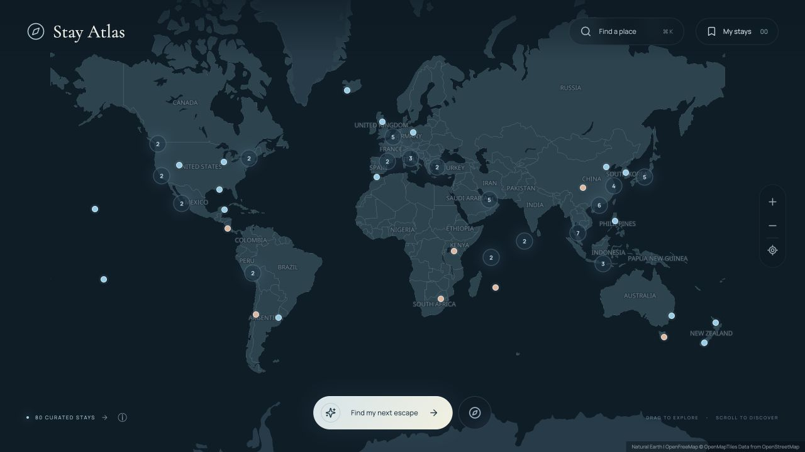

# Stay Atlas

一张地图，发现下一家值得入住的酒店。

Stay Atlas 是一个交互式世界酒店地图，收录 **88 家精选酒店**：希尔顿与万豪各 44 家，覆盖 44 个国家。以简洁的平铺世界地图为入口，按城市、品牌和旅行体验发现酒店，并保存想去与去过的地方。

**[在线体验 →](https://astonishing-pegasus-0d3025.netlify.app/)**



## 功能

- **世界地图探索**：拖动、缩放、酒店聚合点和位置定位；手机端也能查看完整世界地图。
- **轻量地点预览**：悬停或用键盘聚焦地图标记，即可预览酒店名称、品牌与地点；聚合点显示酒店数量和所含城市。按 Escape 收起预览，点击标记继续探索。
- **只看当前地图范围**：拖动或缩放后点击 `Search this area`，将地图和列表限定在当前视野并显示数量。范围只在点击时更新，可与品牌、搜索和收藏叠加；点击 × 取消区域限制，重置世界视图也会清除区域。
- **组合筛选**：按酒店名称、城市、国家、集团、品牌、体验标签和主题旅程筛选。
- **酒店详情**：介绍、推荐理由、官网链接、资料来源与坐标精度说明。
- **酒店分享链接**：打开酒店预览，点击分享图标复制链接；接收者打开后会定位并展开同一家酒店。链接只包含酒店编号，不包含搜索、区域或收藏状态。剪贴板不可用时提供可手动复制的链接；无效酒店编号会提示并回到正常地图。
- **个人收藏**：标记“想去”和“已入住”，保存在浏览器本地。
- **灵感发现**：随机探索当前筛选中的酒店，以及海岛、城市、设计、静谧度假四类旅程。
- **无账号体验**：无需 API Key、注册或后端服务；支持键盘操作和减少动态效果偏好。

## 技术栈

React 19 · TypeScript · Vite · MapLibre GL JS · Lucide · CSS

地图使用 OpenFreeMap / OpenStreetMap 数据；网络地图不可用时保留本地 Natural Earth 世界轮廓。

## 本地运行

需要 **Node.js 22.18+** 和 pnpm。

```bash
pnpm install --frozen-lockfile
pnpm dev --port 4173
```

打开 [http://127.0.0.1:4173/](http://127.0.0.1:4173/)。请通过 HTTP 服务访问，不要直接双击 `index.html`。

### 测试与构建

```bash
pnpm test
pnpm build
pnpm preview --port 4173
```

`pnpm test` 检查酒店唯一性、分组数量、坐标与来源、组合筛选、收藏及主题旅程，以及地图范围边界、跨日期变更线、组合筛选和分享链接的编号往返、参数清理；`pnpm build` 先运行 TypeScript 检查，再生成 `dist/`。

## 部署到 Netlify

可在 Netlify 导入本仓库，使用以下设置：

| 设置 | 值 |
| --- | --- |
| Build command | `pnpm build` |
| Publish directory | `dist` |
| Node.js | `24` |

仓库中的 `netlify.toml` 已保存构建配置。无需环境变量或 API Key。

也可以先执行 `pnpm build`，然后把 `dist/` 文件夹拖入 Netlify 的部署区域。更新现有网站时请使用原项目的部署入口，以保留原网址。

## 项目结构

```text
src/
  main.tsx          页面、搜索筛选、收藏和详情
  MapCanvas.tsx     平铺地图、聚合与定位
  model.ts          数据类型和筛选逻辑
  mapArea.ts        地图范围及跨日期变更线筛选
  hotelLink.ts      单家酒店分享链接
  style.css         界面和响应式样式
public/
  data/hotels.json  酒店资料与来源
  data/            地图样式、世界轮廓和素材版权记录
  images/          本地目的地图片
  fonts/           字体与许可证
  earth/           保留的早期卫星地球素材与来源
  favicon.svg
tests/            数据和筛选测试
```

早期地球渲染代码 `SatelliteEarth.ts` 与相关素材仍保留，但当前平铺地图不使用这些效果。

## 添加酒店

在 `public/data/hotels.json` 中追加记录，并参考 `src/model.ts` 的 `Hotel` 类型。每条记录需要唯一 `id`、酒店名称、集团、品牌、城市、国家、经纬度、官网、介绍、标签、资料来源及核对日期。新增后调整集合数量测试，并运行 `pnpm test` 和 `pnpm build`；界面数量会自动更新。

每家酒店保留独立的资料核对日期：原有 80 家核对于 **2026-10-19**，新增 8 家核对于 **2026-10-27**。本次补充葡萄牙、奥地利、斯里兰卡、纳米比亚、瑞士、阿曼、巴拿马和约旦，每个国家 1 家酒店；新增记录包含官网、坐标来源与精度说明。

当前是精选集合，并非希尔顿或万豪完整名录。坐标采用酒店官网地图或其他已注明的地理来源，部分为近似位置；酒店详情会披露来源和精度，不应作为入口级导航依据。

## 素材与使用说明

- 酒店图片为已标注的**目的地照片**，不代表酒店实拍；没有照片的条目使用地点插画。
- 图片来源与许可证见 [`image-credits.json`](public/data/image-credits.json)。
- 字体许可证保存在 [`public/fonts/`](public/fonts/)。
- 地图来源：[OpenFreeMap](https://openfreemap.org/)、[OpenStreetMap](https://www.openstreetmap.org/copyright)、[Natural Earth](https://www.naturalearthdata.com/about/terms-of-use/)。
- 保留的历史卫星素材来源见 [`earth/credits.json`](public/earth/credits.json)。

酒店品牌、商标及第三方素材的权利归各自权利人所有。本项目与酒店集团没有官方隶属关系。

收藏仅存在当前浏览器中；清理浏览器存储会删除收藏，不同设备和网址之间不会同步。项目不提供实时房价、房态、预订或支付功能。
