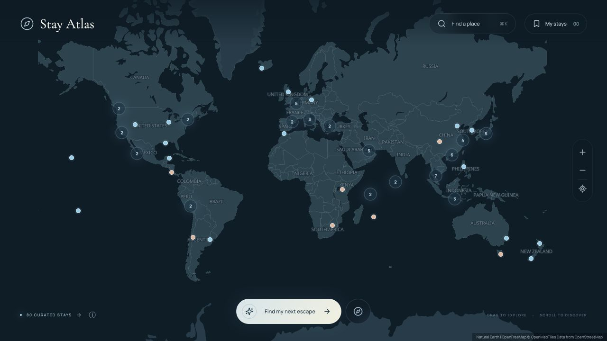

# Stay Atlas

一张地图，发现下一家值得入住的酒店。

Stay Atlas 是一个交互式世界酒店地图，收录 **88 家精选酒店**：希尔顿与万豪各 44 家，覆盖 44 个国家。以简洁的平铺世界地图为入口，按城市、品牌和旅行体验发现酒店，并保存想去与去过的地方。

**[在线体验 →](https://astonishing-pegasus-0d3025.netlify.app/)**



## 功能

- **世界地图探索**：拖动、缩放、酒店聚合点和位置定位；手机端也能查看完整世界地图。
- **轻量地点预览**：悬停或用键盘聚焦地图标记，即可预览酒店名称、品牌与地点；聚合点显示酒店数量和所含城市。按 Escape 收起预览，点击标记继续探索。
- **只看当前地图范围**：拖动或缩放后点击 `Search this area`，将地图和列表限定在当前视野并显示数量。范围只在点击时更新，可与品牌、搜索和收藏叠加；点击 × 取消区域限制，重置世界视图也会清除区域。
- **组合筛选**：按酒店名称、城市、国家、集团、品牌、体验标签和主题旅程筛选。
- **加载失败后重试**：酒店集合加载失败时点击 `Retry`，仅重新请求酒店数据，保留当前筛选、收藏模式、排序与地图位置。请求期间显示 `Retrying…` 并阻止重复请求；再次失败仍可重试。键盘焦点留在按钮，成功后回到结果区域；若已移到其他控件或关闭面板，则不抢焦点。没有自动重试或离线缓存。
- **酒店详情**：介绍、推荐理由、官网链接、资料来源与坐标精度说明。
- **酒店分享链接**：打开酒店预览，点击分享图标复制链接；接收者打开后会定位并展开同一家酒店。链接只包含酒店编号，不包含搜索、区域或收藏状态。剪贴板不可用时提供可手动复制的链接；无效酒店编号会提示并回到正常地图。
- **个人收藏**：标记“想去”和“已入住”，保存在浏览器本地。
- **清晰的收藏入口**：`My stays` 按钮为辅助技术提供完整名称、收藏数量和收藏模式的开关状态；手机隐藏按钮文字后仍可识别，外观与点击行为保持不变。
- **键盘收起面板**：在搜索或收藏面板内按 `Escape`，关闭面板并将焦点返回搜索入口，便于继续键盘操作；保留筛选与收藏模式。焦点位于面板外时不抢焦点，详情等弹窗继续使用原有关闭行为。
- **低矮窗口中的收藏浏览**：桌面视口高度不超过 780px 时，`My stays` 面板整体滚动，让酒店卡片与上方筛选、排序和 CSV 入口都可查看；键盘聚焦会将对应内容带入视野。较高桌面窗口和手机的现有滚动布局保持不变。
- **收藏按国家排序**：在 `My stays` 的 `Sort` 中选择 `Country`，按国家、城市、酒店名依次排列；`Collection order` 恢复原集合顺序。只调整收藏列表的显示顺序，地图、筛选、收藏状态及 CSV 导出范围和顺序不变。排序仅在本次访问中有效，刷新后恢复默认，不跨设备同步。
- **撤销移除收藏**：从列表、预览或详情移除后，提示中约 10 秒内可点击 `Undo`，恢复最近移除酒店原来的想去/已入住状态。鼠标停留或键盘聚焦提示时暂停倒计时；重新收藏同一家会取消旧撤销，连续移除只保留最后一次。撤销不会覆盖其他酒店的新选择，刷新页面后不保留撤销记录。浏览器存储不可用时会说明更改仅对本次访问生效。
- **收藏筛选提示**：已有有效收藏但筛选无结果时，会说明收藏只是被当前条件隐藏。点击 `Show all saved stays` 清除搜索、集团、品牌、体验、状态、旅程和地图区域限制，继续留在 `My stays` 查看完整收藏；不会删除收藏。只有确实没有有效收藏时，才显示首次收藏引导。
- **收藏清单导出**：在 `My stays` 点击 `Export CSV`，下载当前浏览器中的全部有效收藏，包含酒店名称、城市、国家、品牌、想去/已入住状态及官网链接。导出包含被搜索、地图区域或其他筛选隐藏的收藏；空收藏时按钮不可用。文件在浏览器内生成，不上传收藏数据，也不提供导入或跨设备同步。
- **导出前的数据状态**：酒店资料尚在加载时，收藏导出区提示等待；加载失败时提示先点击下方 `Retry`，不再误报需要先收藏酒店。资料未就绪时导出按钮禁用，并使用不含虚假零数量的可访问名称；加载成功后恢复原有数量、范围说明和导出行为，只有确实没有有效收藏时显示首次导出引导。
- **灵感发现**：随机探索当前筛选中的酒店，以及海岛、城市、设计、静谧度假四类旅程。
- **无账号体验**：无需 API Key、注册或后端服务；支持键盘操作和减少动态效果偏好。

## 技术栈

React 19 · TypeScript · Vite · MapLibre GL JS · Lucide · CSS

地图使用 OpenFreeMap / OpenStreetMap 数据；网络地图不可用时保留本地 Natural Earth 世界轮廓。

## 本地运行

需要 **Node.js 22.18+** 和 pnpm。

```bash
pnpm install --frozen-lockfile
pnpm dev --port 4173
```

打开 [http://127.0.0.1:4173/](http://127.0.0.1:4173/)。请通过 HTTP 服务访问，不要直接双击 `index.html`。

### 测试与构建

```bash
pnpm test
pnpm build
pnpm preview --port 4173
```

`pnpm test` 检查酒店唯一性、分组数量、坐标与来源、组合筛选、收藏及主题旅程，以及地图范围边界、跨日期变更线、组合筛选和分享链接的编号往返、参数清理；CSV 测试覆盖导出范围、空收藏、状态、中文、逗号、引号、换行和公式前缀处理。撤销测试覆盖原状态恢复、连续移除、重新收藏、过期操作、保留其他新选择及存储写入失败。`pnpm build` 先运行 TypeScript 检查，再生成 `dist/`。

收藏排序测试覆盖国家、城市和酒店名的排序层级、完全同名项的稳定顺序、重音字符、输入不可变，以及筛选结果和 CSV 原顺序不受影响。

数据加载测试覆盖成功、HTTP/网络/JSON 错误、重复激活、失败后再次请求，以及取消请求后旧响应不覆盖新请求。本地受控故障预览用于验证重试时的筛选、收藏、排序、地图与键盘焦点保留。

CSV 使用带 BOM 的 UTF-8 编码和 CRLF 行分隔，状态列为 `Want to visit` / `Stayed`。仅导出仍在当前酒店集合中的有效收藏，顺序与集合一致。字段统一加双引号并转义；可能被表格识别为公式的开头加单引号作为文本处理。重新编辑、另存文件时，表格软件可能改变这种处理。

## 部署到 Netlify

可在 Netlify 导入本仓库，使用以下设置：

| 设置 | 值 |
| --- | --- |
| Build command | `pnpm build` |
| Publish directory | `dist` |
| Node.js | `24` |

仓库中的 `netlify.toml` 已保存构建配置。无需环境变量或 API Key。

也可以先执行 `pnpm build`，然后把 `dist/` 文件夹拖入 Netlify 的部署区域。更新现有网站时请使用原项目的部署入口，以保留原网址。

## 项目结构

```text
src/
  main.tsx          页面、搜索筛选、收藏和详情
  MapCanvas.tsx     平铺地图、聚合与定位
  model.ts          数据类型和筛选逻辑
  mapArea.ts        地图范围及跨日期变更线筛选
  hotelLink.ts      单家酒店分享链接
  hotelLoader.ts    可重试的酒店集合请求与取消处理
  savedStaysCsv.ts  收藏筛选与 CSV 编码
  savedStaysUndo.ts 最近移除收藏的恢复与失效规则
  savedStaysSort.ts 收藏列表的国家排序（不改变源集合）
  style.css         界面和响应式样式
public/
  data/hotels.json  酒店资料与来源
  data/            地图样式、世界轮廓和素材版权记录
  images/          本地目的地图片
  fonts/           字体与许可证
  earth/           保留的早期卫星地球素材与来源
  favicon.svg
tests/            数据和筛选测试
```

早期地球渲染代码 `SatelliteEarth.ts` 与相关素材仍保留，但当前平铺地图不使用这些效果。

## 添加酒店

在 `public/data/hotels.json` 中追加记录，并参考 `src/model.ts` 的 `Hotel` 类型。每条记录需要唯一 `id`、酒店名称、集团、品牌、城市、国家、经纬度、官网、介绍、标签、资料来源及核对日期。新增后调整集合数量测试，并运行 `pnpm test` 和 `pnpm build`；界面数量会自动更新。

每家酒店保留独立的资料核对日期：原有 80 家核对于 **2026-10-19**，新增 8 家核对于 **2026-10-27**。本次补充葡萄牙、奥地利、斯里兰卡、纳米比亚、瑞士、阿曼、巴拿马和约旦，每个国家 1 家酒店；新增记录包含官网、坐标来源与精度说明。

当前是精选集合，并非希尔顿或万豪完整名录。坐标采用酒店官网地图或其他已注明的地理来源，部分为近似位置；酒店详情会披露来源和精度，不应作为入口级导航依据。

## 素材与使用说明

- 酒店图片为已标注的**目的地照片**，不代表酒店实拍；没有照片的条目使用地点插画。
- 照片加载期间先显示该地点的插画，成功后柔和淡入；加载失败时保留插画。切换酒店会重建图片加载状态，避免旧请求影响新地点；已缓存照片也可正常显示。遵循系统的减少动态效果设置，不播放淡入或持续加载动画。
- 图片来源与许可证见 [`image-credits.json`](public/data/image-credits.json)。
- 字体许可证保存在 [`public/fonts/`](public/fonts/)。
- 地图来源：[OpenFreeMap](https://openfreemap.org/)、[OpenStreetMap](https://www.openstreetmap.org/copyright)、[Natural Earth](https://www.naturalearthdata.com/about/terms-of-use/)。
- 保留的历史卫星素材来源见 [`earth/credits.json`](public/earth/credits.json)。

酒店品牌、商标及第三方素材的权利归各自权利人所有。本项目与酒店集团没有官方隶属关系。

收藏仅存在当前浏览器中；清理浏览器存储会删除收藏，不同设备和网址之间不会同步。项目不提供实时房价、房态、预订或支付功能。
